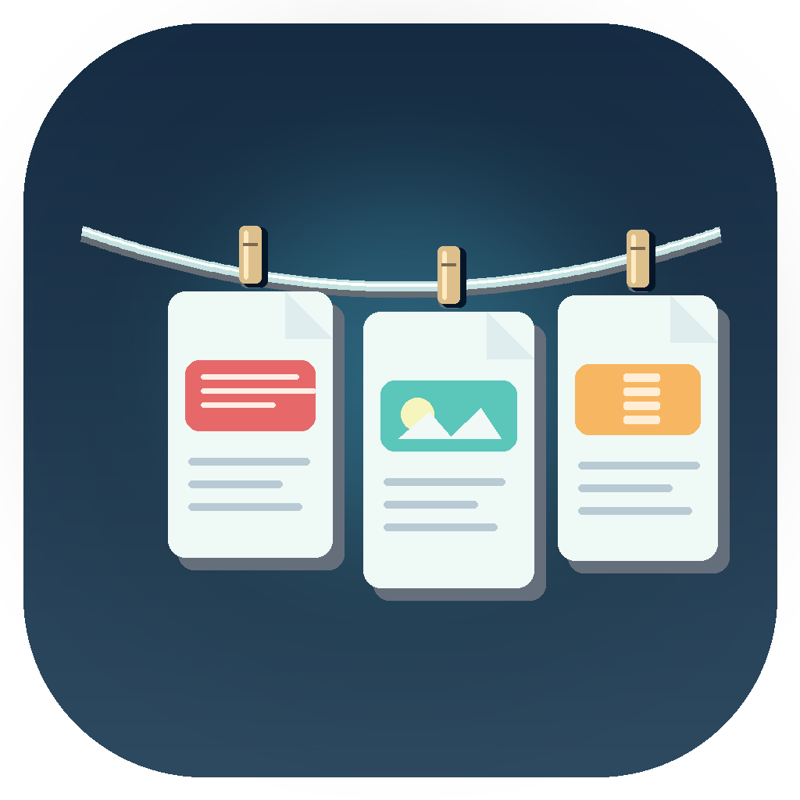

#  Clothesline

**English** · [简体中文](README.md)

**Hang recently downloaded files at the top of your Mac screen.**

Clothesline is a native macOS file utility that presents recent files and folders as cards on a clothesline at the top of your screen, ready to preview, open, drag, and manage.

It watches Downloads by default. Add more watched folders or hang frequently used folders as shortcuts. Choose automatic hiding or keep the clothesline visible. Removing a card only hides its shortcut; a separate, confirmed Move to Trash action manages the original file. Everything runs locally, without an account or cloud service.

**Status: V0.1 release candidate.** Built on macOS 26.6.2 / Apple Silicon. Core and macOS integration tests cover watching real files and safe file operations. Full manual UI acceptance remains pending; see [project state](PROJECT_STATE.md).

## Demo

A 36-second recording showing file cards and colorful clothespins. The latest rc.2 installer includes the colorful clothespins.

https://github.com/user-attachments/assets/aab83014-934a-43c0-bc72-8055df02e67b

[Download the demo (MP4, about 4 MB)](https://github.com/zhongguozhang/Clothesline/releases/download/v0.1.0-rc.1/Clothesline-demo.mp4)

## Download and install

[Download DMG for Apple Silicon](https://github.com/zhongguozhang/Clothesline/releases/download/v0.1.0-rc.2/Clothesline-0.1.0-rc.2-arm64.dmg) · [Release notes and SHA-256 checksum](https://github.com/zhongguozhang/Clothesline/releases/tag/v0.1.0-rc.2)

Requires macOS 14+ and an Apple Silicon Mac. This release does not include an Intel installer. Open the DMG, drag Clothesline.app into Applications, and launch it.

The candidate uses ad-hoc signing and has not been signed with Developer ID or notarized by Apple. macOS may block the first launch. Verify that you downloaded it from this repository, then follow the system's Privacy & Security instructions to allow opening it.

The application interface currently uses Chinese. This English page translates the documentation, not the application interface.

## New workflows (development source)

- Right-click a file or folder to Pin / Unpin. Pinned items survive new arrivals and restarts; overflow can be scrolled. Removing an item unpins it; clearing unpins all without deleting originals.
- Hover for the full name, source folder, size, creation and modification time. Folder size is not calculated recursively. Missing/inaccessible cards remain marked unavailable with last-known metadata and recover when accessible again.

- Drag one or multiple Finder files/folders onto the revealed clothesline. Only references are stored; originals stay in place. A file picker is also available.
- Right-click a card → Rename to change the original name while retaining its extension. Conflicts and stale files are rejected without overwriting.
- Clipboard images/screenshots and text have independent switches, both off by default. Automatic intake handles new copies only; Hang Current Clipboard works manually with both switches off.
- Text becomes a note with preview, double-click editing, copy, and Save As. Images support preview, copying, and Save As. Duplicate content is not added again; the app ignores its own automatic clipboard feedback.
- Only clipboard screenshots are handled. Saved screenshots are ordinary files, displayed only through existing folder monitors or manual attachment.
- Clipboard copies are local and session-only, excluded from persistent recent-file bookmarks. Quitting or Clear Clipboard Items cleans owned copies without touching exported files; an abnormal exit may leave copies in the system temporary directory. Limits: 100 items per session, image inputs up to 32 MB, text up to 200 KB. Copied text may contain sensitive information; enable it only when wanted.
- Open Recent Files from the rope or menu to search up to 200 persistent recent file references, drag them out, or hang them again. Missing/inaccessible originals are omitted.
- Right-click → Share opens the macOS share picker. Available services depend on your system and installed apps.

These additions are in source and the local build; the rc.2 DMG remains the preceding candidate. End-to-end mouse interaction and actual sharing require manual acceptance.

## Features

- Watch Downloads and multiple additional folders simultaneously. Added folders persist across restarts; the menu lists each folder and any access errors.
- Show recent files and top-level folders, and automatically check newly added items.
- Hang selected folders as persistent shortcuts without moving them. This is separate from watching their contents.
- Filter hidden files, symbolic links, and temporary downloads such as `.crdownload`, `.download`, `.part`, and `.tmp`.
- Wait for two stable scans and at least two seconds without changes before displaying a file. A corresponding temporary download also prevents it from appearing.
- Generate thumbnails for supported documents, images, and videos; use system icons for other files and folders.
- Cycle six clothespin colors, with different colors on neighboring cards, and retain spring animations and highlights.
- Preview with Quick Look, open in the default app, reveal in Finder, copy, hide, or move to Trash.
- Drag real file URLs into other apps or Finder. The source offers copy only; the receiving app decides how to handle the drop.
- Choose automatic hiding or always-visible mode, remembered across restarts. Use `⌃⌥T` to toggle pinned visibility.

## Quick reference

| Action | Result |
|---|---|
| Hover at the top of the screen / menu bar | Show the clothesline |
| Move the pointer away | Hide it in automatic mode |
| Click a file | Quick Look preview |
| Double-click | Open with the default app; folders open in Finder |
| Drag to an app or Finder | Offer the real file for copying |
| Right-click | Preview, open, reveal, copy, remove, or move to Trash |
| Move to Trash | After confirmation, move the original item and any folder contents to macOS Trash |
| × / remove / clear | Hide cards; preserve original files |
| Add watched folder (添加监控文件夹…) | Add folders while existing watchers continue |
| Hang folder (挂上文件夹…) | Add folder shortcuts without moving them |
| Always visible / auto-hide | Save the display preference |
| Show removed files again | Clear hidden-item records |
| `⌃⌥T` | Toggle pinned visibility |

## Build from source

Requires macOS 14+ and Apple Command Line Tools (Swift 5.9+) or Xcode.

```bash
cd Clothesline
scripts/test-core.sh
scripts/test-macos.sh
scripts/build-app.sh release
open build/Clothesline.app
```

Use `scripts/build-app.sh debug` for a debug build. The script builds for the host architecture and signs locally with ad-hoc signing by default. Set `SIGN_IDENTITY` to use an installed signing identity; Apple notarization is a separate step. Build a DMG with `scripts/build-dmg.sh`.

macOS may request folder access. If watching fails, use the T-shirt menu bar icon → 添加监控文件夹… and select Downloads. Bookmarks retain access when available; rebuilding may trigger another permission request.

## Safety and limitations

- Removing cards, clearing the clothesline, or quitting does not delete, move, or overwrite original files. Only the separately confirmed Trash action moves originals. No permanent deletion is provided; folders move with all their contents.
- Download completion is heuristic. A download paused for more than two seconds under its final filename without a companion temporary file may appear early.
- Watching is limited to top-level items and does not recursively monitor folder contents. Folder stability does not guarantee every contained file has finished writing.
- Preferences, folder bookmarks, and hidden-item records are stored locally. The app has no network logic, telemetry, accounts, or screenshot capture. Clipboard content is read only for explicitly enabled types or a manual capture.
- Integration tests verify real directory events, file URLs, safe removal, Trash recovery, multiple watchers, bookmark restoration, and drag payloads. Actual receiving-app drag behavior, full UI interactions, browser downloads, permission denial, sleep, multiple displays, and macOS 14 compatibility still require manual acceptance.
- Developer ID notarization, automatic updates, launch at login, full accessibility, and additional application languages are not included.

## Copyright and origin

Tendedero source code is published under MIT by Alejandro Buján. Clothesline adapts its clothesline structure, floating interactions, animation, and card design ideas. See the [upstream license](https://github.com/alejandrobujan/tendedero/blob/main/LICENSE). The upstream name, icon, and documentation images are not used. Clothesline has an independent name and icon; the full license and original copyright notice are retained in [LICENSE](LICENSE), including inside the app bundle.

## Ongoing development

Development follows [AGENTS.md](AGENTS.md). Each iteration updates [PROJECT_STATE.md](PROJECT_STATE.md), [HANDOFF_LATEST.md](HANDOFF_LATEST.md), and [CHANGELOG.md](CHANGELOG.md). Verified changes are committed and pushed to this public repository without force-pushing. See [ROADMAP.md](ROADMAP.md) for pending acceptance work.
